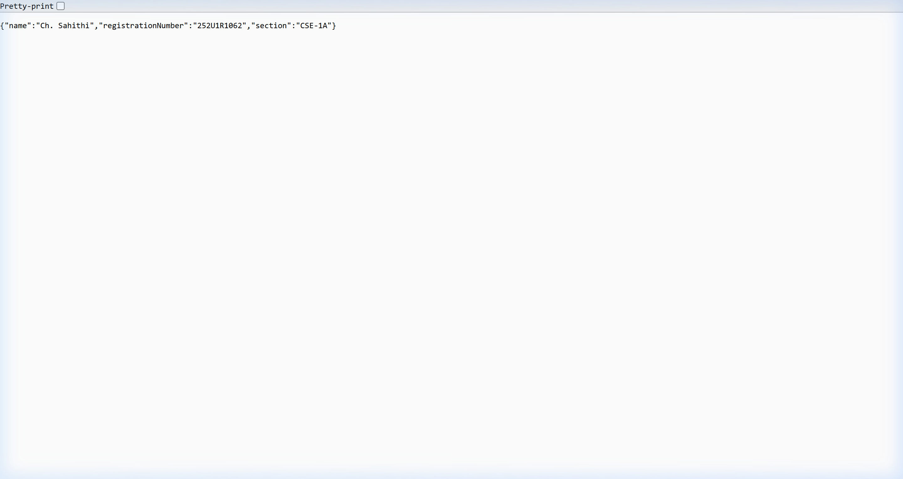

# Lab 1: Node.js and Express Server

**Name:** Ch. Sahithi  
**Registration number:** 252U1R1062  
**Section:** CSE-1A

## Architecture

The project separates the server startup, Express app configuration, and route definitions:

```text
lab-01/
├── server.js                  # Starts the Express server
├── http-server.js             # Task 3: built-in Node.js HTTP server
├── src/
│   ├── app.js                  # App configuration and 404 fallback
│   └── routes/
│       └── mainRoutes.js       # GET route handlers
├── package.json
└── README.md
```

**Request flow:** Browser/client → `server.js` → `src/app.js` → `src/routes/mainRoutes.js` → response.  
Unknown paths continue to the 404 fallback in `src/app.js`.

## How to run

Use Node.js and npm from this folder:

```bash
npm install
npm start
```

Then open `http://localhost:3000`. To run the plain HTTP server instead, stop the Express server and run:

```bash
npm run plain
```

Both servers use port `3000` by default. Set the `PORT` environment variable to use a different port.

## Express routes and expected results

| Method | Path | Status | Output |
|---|---|---:|---|
| GET | `/` | 200 | `Welcome to the Node.js and Express server!` |
| GET | `/about` | 200 | JSON containing name, registration number, and section |
| GET | `/time` | 200 | Current date and time |
| GET | Any unknown path, e.g. `/unknown` | 404 | `404 - Page Not Found` |

Example `/about` response:

```json
{
  "name": "Ch. Sahithi",
  "registrationNumber": "252U1R1062",
  "section": "CSE-1A"
}
```

## Screenshots

### 🏠 Home Route — `GET /`


### 👤 About Route — `GET /about`


### 🕐 Date & Time Route — `GET /time`


### ❌ 404 Error — Unknown Route


## Built-in HTTP server (Task 3)

`http-server.js` uses Node's built-in `http` module. `GET /` returns `Hello` with status `200`; other paths return `404 - Page Not Found` with status `404`.

## Important concepts

- **`package.json`:** project metadata, dependency list, and npm commands.
- **`node_modules`:** downloaded dependencies created by `npm install`; it does not need to be submitted.
- **`app.listen()`:** starts the Express app listening for requests on a port.
- **Request and response:** `req` contains incoming request details; `res` is used to send status codes, headers, and response data.
- **404 handler:** place it after valid routes so that it only handles requests that do not match another route.

## Problems faced and solutions

1. **Keeping the code organized:** moved route handlers into `src/routes/mainRoutes.js` and kept server startup in `server.js`.
2. **Handling unknown URLs:** added a final 404 middleware after the route module.
3. **Avoiding port conflicts:** stop one server before starting the other, or configure a different `PORT`.
4. **Returning structured data:** used `res.json()` for `/about` so the client receives valid JSON.
5. **Showing the current time:** created a fresh `Date` object whenever `/time` is requested.

## Testing checklist

- [ ] Run `npm install`
- [ ] Run `npm start`
- [ ] Visit `/`, `/about`, and `/time`
- [ ] Visit `/unknown` and confirm status `404`
- [ ] Stop Express, run `npm run plain`, and test `/` and `/unknown`
